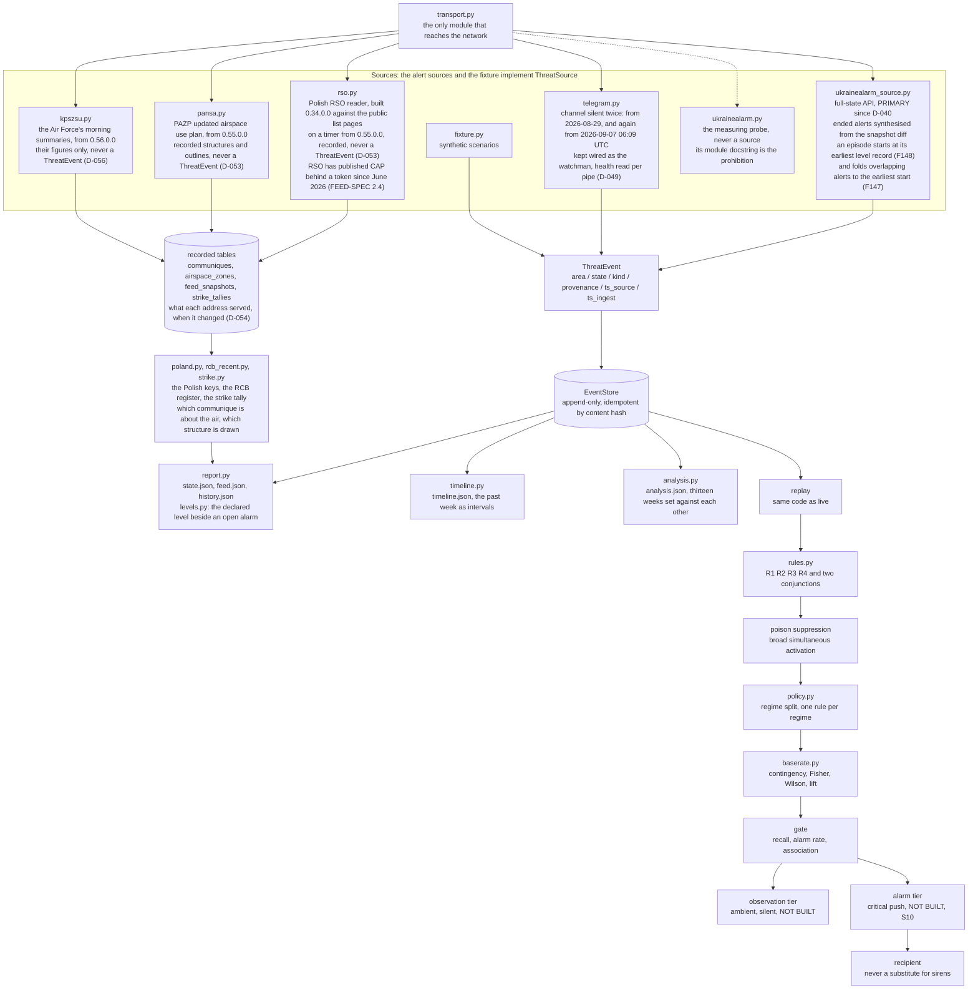

# ARCHITECTURE

The infrastructure architecture: what components exist, what may talk to what,
where the process boundaries are, and which dependency rules a change must not
break. `DATA-FLOW.md` is the companion and answers the other question, what
happens to a message as it travels.

```
Document:  docs/ARCHITECTURE.md, version 2.9
Audience:  a contributor about to add a module, a dependency, or a process
Companion: DATA-FLOW (what happens to the data), MECHANISMS (why each mechanism
           is built the way it is), METHODOLOGY (what may be claimed)
Note:      the block index is maintained as a table so that a rename leaves a
           visibly stale row. It gained no row between sprint 2 and sprint 6 and
           was two releases out of date when audited (F43)
```

## Contents

1. [The component map](#the-component-map)
2. [Block index](#block-index)
3. [Module reference](#module-reference)
4. [Dependency rules](#dependency-rules)
5. [The four boundaries](#the-four-boundaries)
6. [Process and deployment shape](#process-and-deployment-shape)
7. [Extension points](#extension-points)
8. [Repository layout beyond the package](#repository-layout-beyond-the-package)
9. [What is not here](#what-is-not-here)

## The component map



The dashed edge is the probe, which is never a source. The two Polish readers
and the Air Force reader feed recorded tables and composers of their own rather
than `ThreatEvent`: a communique, an airspace structure and a night's tally are
not alert transitions, and folding them into that type would be the modelling
error F25 recorded (D-053, D-056). **The branches that end in `report.py`,
`timeline.py` and `analysis.py` are what the contract is made of; the chain
from replay to the gate is the decision path, and it publishes nothing**: no
rule, policy or gate feeds any file the site reads.

Until 0.55.0.0 the RSO edge was dashed too. The boundary is the point of the
drawing: everything downstream of `ThreatEvent` is blind to which feed produced
it, so adding a Ukrainian source is an implementation rather than a rewrite. The
API, the channel and the probe all draw on one Ukrainian upstream and are one
dependency (MT9, D-010). The Polish readers and the Air Force reader are
dependencies of their own, and none can make the Ukrainian picture blind: a
failure there reaches `state.json` as a `null` key of its own and nothing
else.


## Block index

One row per block. A block with no row is a block nobody agreed to.

Maintained as a table so that a rename leaves a visibly stale row.

| Block | Where it lives | What it does |
| --- | --- | --- |
| `ThreatSource` implementations | `mavo/schema.py`, `mavo/sources/` | The adapter boundary. Everything above is blind to which feed produced an event, which makes a new feed an implementation rather than a rewrite |
| `ThreatEvent` | `mavo/schema.py` | Normalized transition. Stores both source and ingest time because the difference is the feed latency that eats the warning budget |
| `AlertState` | `mavo/schema.py` | Four states. UNKNOWN is silence, PARTIAL_CLEAR is contradiction, and neither resolves to CLEAR |
| transport | `mavo/transport.py` | The only module that imports a network client. One answer, in one place, to what this tool can talk to |
| API adapter | `mavo/sources/ukrainealarm_source.py` | **The primary source since D-040.** A full-state snapshot presented as the transitions the collector expects: an ended alert is synthesised from the difference between two polls, dated by the observation, and only when the previous observation actually happened - a persisted snapshot older than its ceiling licenses no clears |
| Telegram adapter | `mavo/sources/telegram.py` | The watchman since D-040: the channel fell silent 2026-08-29 and this stays wired so a returned publisher lands labelled rather than remembered. Parses the public channel page; area resolution runs on the channel's own tags since S7 (the pre-S7 pattern table measured 0 of 20, F23, and was replaced rather than repaired), and it reports the skipped message window rather than assuming continuity |
| `EventStore` | `mavo/store.py` | Append-only log of transitions, never snapshots. Idempotent by content hash so a re-poll costs nothing |
| recorded tables | `mavo/store.py` | What this program did rather than what it derived: `feed_attempts`, `communiques`, `alert_levels`, and from 0.55.0.0 `feed_snapshots` (the ordered list one address served, written on change, D-054), `airspace_zones` and `airspace_geometries`. Extended additively, never refused (D-036); every open prints what it moved (F168) |
| Polish readers | `mavo/sources/rso.py`, `mavo/sources/pansa.py` | RSO communiques and the PAŻP updated airspace use plan, on timers from 0.55.0.0 (D-053). Neither yields a `ThreatEvent`; both record everything the feed said and decide nothing about it (D-034) |
| Polish composer | `mavo/poland.py` | `pl_warnings`, `pl_all_clear` and `pl_airspace` for `state.json`, from the recorded tables and the newest list per address. Decides which communique is about the air, which all-clear ends which alert (D-055) and which structure is drawn; the rules and their tests are `mavo-site` 4.76.0.0's, ported, with three named differences |
| RCB register | `mavo/rcb_recent.py` | `pl_rcb_recent`: the last forty-eight hours of RCB air alerts per voivodeship, what painted and how each ended, and the stretches in which the list was not read (D-062) |
| strike tally | `mavo/sources/kpszsu.py`, `mavo/strike.py` | The Air Force's morning summaries read into figures, and `strike_tally` and `strike_history` composed from them. Their figures only: a count they do not state stays unknown, and no rate or trend is computed (D-056, D-057) |
| area resolution | `mavo/areas.py`, `data/reference/` | A channel tag or an API region to a KATOTTG code, the oblast slug and the distance interval to the border |
| means of attack | `mavo/kinds.py` | The kind of an alert, joined to it rather than read off it, and published as not stated where the source does not say (D-042) |
| report | `mavo/report.py` | The fold per area and kind, staleness, `state.json`, `feed.json` and `history.json`, and the `--watch` loop that writes them |
| declared level | `mavo/levels.py`, `mavo/level_reading.py` | Which level the source lists beside an open alarm at a moment, verbatim (D-063), and the operator's read of the level stream |
| pipe health | `mavo/liveness.py`, `mavo/attempts.py` | Which pipes are delivering, from `feed_attempts` and never from events (D-049), and the completeness of one feed's attempts |
| latency instrument | `mavo/latency.py` | Post time against receipt, as a distribution and an upper bound on the upstream, never a measurement of it (T40) |
| run log | `mavo/obs.py` | One writer, one schema, no message text |
| the week | `mavo/timeline.py`, `mavo/recorder.py` | `timeline.json`, the past seven days as half-open intervals per area, RCB, PAŻP and coverage (D-058), and a week of the store recorded as a fixture |
| the weekly analysis | `mavo/analysis.py` | `analysis.json`: thirteen Warsaw weeks of the border band and of RCB's alerts, per observed minute, with every comparison the page offers computed here (D-064) |
| replay | `mavo/store.py` | Reconstructs any past moment. The backtest and the live correlator run this same path |
| rules | `mavo/rules.py` | Explicit predicates returning the moment they fire, which is what makes lead time measurable. R1 to R4 plus the missile and drone conjunctions |
| poison suppression | `mavo/rules.py` | Hard control against a source claiming implausibly broad simultaneous activation |
| decision policy | `mavo/policy.py` | Binds one rule per timing regime. The shared attention budget it used to allocate was removed at 0.8.0.0 (D-014) |
| evaluation | `mavo/evaluate.py` | Scores rules and policies against ground truth, and counts the crossing kinds no regime serves |
| base rate | `mavo/baserate.py` | The null model. Contingency table, one-sided Fisher, Wilson interval, lift against the unconditional rate |
| gate | `mavo/baserate.py` | Three conditions, any failure decisive. Alarm rate is a control, not a metric |
| refusal taxonomy | `mavo/errors.py` | Every failure is a refusal with a type. There is no warning type in this codebase |
| CLI | `mavo/cli.py` | Seventeen subcommands, `mavo --help` lists them, and `tools/manual_audit.py` holds each to its section in `docs/MANUAL.md` |
| attack harness | `tests/harness/` | One scripted attack per threat-model row, mutation-verified by `tools/harness_mutation.py` |
| observation tier | not built | Ambient, silent, high volume |
| alarm tier | not built, S10 | Critical push, only for a rule that cleared the gate |

## Module reference

One entry per module: what it owns, what it exports, what it may import, and the
invariant a change must not break. **The line counts are a dated reading, not a
regenerated figure**: this sentence said they were regenerated at each release,
and nothing regenerated them; the counts below were re-read at 0.61.0.1 with
`wc -l mavo/*.py mavo/sources/*.py`. The entries cover the modules of the
decision path and the first adapter; the modules added since are in the block
index above and in the table at the end of this section.

### `mavo/schema.py` (430 lines)

**Owns** the vocabulary. Everything else in the package speaks in these types.

| Export | Kind | Notes |
| --- | --- | --- |
| `AlertState` | enum, 4 members | ACTIVE, CLEAR, UNKNOWN, PARTIAL_CLEAR |
| `ThreatKind` | enum | MISSILE, DRONE, UNKNOWN |
| `Provenance` | enum | measured, reported, inference, speculation |
| `ThreatEvent` | frozen dataclass | area, state, kind, ts_source, ts_ingest, source_id, provenance |
| `ThreatSource` | runtime-checkable Protocol | `source_id: str`, `poll() -> Sequence[ThreatEvent]` |
| `is_clear`, `is_actionable` | predicates | Affirmative, never negations |
| `BORDER_OBLASTS` | frozenset | The areas a crossing could originate from |

**Imports:** standard library only. **Invariant:** no module here imports from
`sources/`. The vocabulary cannot depend on who speaks it.

### `mavo/errors.py` (68 lines)

**Owns** the refusal taxonomy. `SourceUnavailable`, `NaiveTimestamp`,
`UnknownScenario`. The two budget refusals left with the budget (D-014). **There is no warning type**, and adding one is a change this
repository rejects rather than reviews.

**Invariant:** `SourceUnavailable` is raised for reachability only. A content
failure that raises it makes an outage and an unparseable page indistinguishable
to every caller.

### `mavo/transport.py` (448 lines)

**Owns** the only import of a network client in the package.

| Export | Purpose |
| --- | --- |
| `Transport` | Protocol: `fetch(url) -> str` |
| `UrllibTransport` | The real one. Standard library, bounded in time and size |
| `StubTransport` | Returns a fixed body, counts calls |
| `FailingTransport` | Always raises. Models an unreachable source |

**Invariant, checked by lint:** exactly one module imports a network client. The
three transports exist so that every adapter test injects one and no test needs a
network.

### `mavo/store.py` (1,778 lines)

**Owns** durability. Append-only SQLite log of transitions, idempotent by content
hash, replayable to any past moment, and beside it the recorded tables: what
each pipe attempted, what each Polish address served, the declared levels and
the Air Force's nights. A table or column a release adds is created on open and
printed as a `[STORE-MIGRATED]` line; nothing is refused (D-036).

**Invariant:** append is idempotent and appending nothing is not an error. The
content hash excludes `ts_ingest`; a change that includes it grows the log
without bound and breaks every backtest silently (MT8).

### `mavo/baserate.py` (286 lines)

**Owns** the null model and the gate. Contingency table, one-sided Fisher via
`math.comb`, Wilson interval, lift, and `gate()` with its three conditions.

**Invariant:** it stays top-level, checked by `lint_domain`. It is the point of
the project and stays visible in a directory listing.

### `mavo/rules.py` (156 lines)

**Owns** the candidate rules as explicit predicates and the poison suppression
that every one of them calls first.

**Invariant:** a rule returns the moment it fires or `None`, never a boolean.
That signature is what makes lead time measurable.

### `mavo/policy.py` (101 lines)

**Owns** the regime split. `Regime`, `RegimeRule`,
`DecisionPolicy`, `equal_split`.

**Invariant:** `DecisionPolicy` refuses construction when allocated shares exceed
the total. An over-allocated policy that can be built is one that will be run.

### `mavo/evaluate.py` (177 lines)

**Owns** scoring against ground truth: `run_rule`, `run_policy`, `plan_policy`,
and the coverage-gap accounting.

**Invariant:** unserved crossing kinds are counted and printed, never removed
from a denominator.

### `mavo/backfill.py` (453 lines)

**Owns** corpus acquisition. Backwards paging, verbatim snapshots named by id
range, contiguity from filenames, the advisory directory lock, six named stop
conditions.

**Invariant:** it parses nothing beyond post ids. A corpus filtered through the
pattern table it exists to fix is not evidence.

### `mavo/sources/fixture.py` (222 lines)

**Owns** the synthetic history: scenarios, `Night`, `generate_history`.

**This is not a simulation of Ukraine.** It is a device for exercising the
decision path, and every number derived from it is a property of the device.
Stated here because it is the claim most likely to be quietly dropped when the
numbers look good.

### `mavo/sources/telegram.py` (637 lines)

**Owns** the channel adapter, the primary until D-040 and the watchman since:
two independent regexes, three classification layers, the window-gap
computation. The primary adapter is `mavo/sources/ukrainealarm_source.py`.

**Measured state, two eras, both kept.** Pre-S7: state layer 15 of 20, means
layer 4 of 20, area layer **0 of 20**, so the classifier scored 0 of 20 overall
(F23) - the failure that forced the redesign. Since S7 the area layer runs on
the channel's own tags against the KATOTTG register (`docs/CHANNEL.md` holds
the coverage measurement), and the twenty-message sample resolves 20 of 20. The
sentence this replaces still described the pre-S7 table at 0.37.0.1, thirteen
sprints after it was replaced.

### `mavo/cli.py` (1,866 lines)

**Owns** the operator surface, seventeen subcommands from `fixture` to
`analysis`, and the exit codes that carry refusals to a shell.

**Invariant:** every subcommand has a section in the manual, checked by
`tools/manual_audit.py`.

### Modules added since this reference was written

| Module | Lines | Owns |
| --- | --- | --- |
| `mavo/sources/ukrainealarm_source.py` | 481 | The primary adapter since D-040: the snapshot diff and the synthesised clear |
| `mavo/sources/ukrainealarm.py` | 329 | The measuring probe, never a source |
| `mavo/sources/rso.py` | 407 | The RSO reader |
| `mavo/sources/pansa.py` | 369 | The PAŻP reader |
| `mavo/sources/kpszsu.py` | 724 | The Air Force reader |
| `mavo/areas.py` | 425 | Area resolution |
| `mavo/kinds.py` | 215 | The means of attack |
| `mavo/report.py` | 1,961 | The fold, the contract files and the loop |
| `mavo/poland.py` | 723 | The Polish keys |
| `mavo/rcb_recent.py` | 442 | The RCB register |
| `mavo/strike.py` | 440 | The strike keys |
| `mavo/levels.py` | 383 | The declared level at a moment |
| `mavo/level_reading.py` | 131 | The level stream read for the operator |
| `mavo/liveness.py` | 387 | Pipe health |
| `mavo/attempts.py` | 305 | Attempt completeness |
| `mavo/latency.py` | 386 | The latency instrument |
| `mavo/obs.py` | 284 | The run log |
| `mavo/timeline.py` | 797 | The week |
| `mavo/recorder.py` | 209 | A week recorded as a fixture |
| `mavo/analysis.py` | 1,523 | The weekly analysis |

Each module's docstring states its invariant; the dependency rule below binds
them all.

## The four boundaries

A boundary is a place where one side may be replaced without the other noticing.
There are four, and knowing which one a change crosses is most of a review.

| Boundary | Between | Crossed by | What it buys |
| --- | --- | --- | --- |
| **Source** | `ThreatSource` implementations and everything above `ThreatEvent` | Adding a feed | A new feed is an implementation, not a rewrite. Nothing downstream knows which feed produced an event |
| **Transport** | Adapters and the network | Injecting a transport | Every adapter is testable offline, and "what can this talk to" has one answer in one file |
| **Store** | Ingestion and evaluation | `replay` | The backtest and a future live correlator run the same path, so a rule cannot behave differently in test than in production |
| **Rule** | Predicates and scoring | The `Rule` signature | Rules know nothing about recall, budgets or lead time. Scoring knows nothing about oblasts |

**A change that blurs one of these is a change to argue about, not to merge.**
The most likely blur is the decision layer importing an adapter, which inverts
the source boundary and makes the adapter unreplaceable.


## Dependency rules

Four rules. Each is enforced by something in `make verify`, or it is not a rule.

| Rule | Enforced by | Why |
| --- | --- | --- |
| One top-level package, `mavo` | `tests/lint_domain.py` | A second namespace is where a parallel implementation starts |
| The network is reachable from exactly one module | `tests/lint_limitations.py`, claim `network_reach_is_one_file` | "What can this thing talk to" must have one answer in one place, and every adapter must be testable without a network |
| Runtime dependencies stay empty | `pyproject.toml` is the single source of truth; a new one requires a changelog entry justifying it | The product is a measurement, and a measurement with an unaudited dependency tree is weaker than one without |
| `baserate.py` stays top-level | `tests/lint_domain.py` | It is the point of the project and stays visible in a directory listing |

**The direction of dependency is one-way.** Sources import from `schema` and
`transport`. Nothing in `schema`, `store`, `rules`, `policy`, `baserate` or
`evaluate` imports from `sources`, except the fixture's `Night` type, which is a
seam that will move when live nights exist. A change that makes the decision
layer import an adapter has inverted the boundary that makes the adapter
replaceable.

## Process and deployment shape

Two process shapes. **Most commands run, do one thing and exit**; on the host
each reader is such a command started by its own systemd timer (D-031). **One
is resident**: `mavo report --watch`, the loop that writes the contract every
thirty seconds and the week every tenth cycle.

| Command | Reaches the network | Writes | Runs for |
| --- | --- | --- | --- |
| `mavo fixture` | No | The event store | Seconds |
| `mavo gate`, `mavo policy` | No | Nothing | Seconds |
| `mavo backfill` | Yes | `data/raw/` snapshots | Minutes to hours |
| `mavo collect` | Yes | The store's events and attempts, or one snapshot | One request |
| `mavo collect-api` | Yes | The store's events, attempts and levels, and the snapshot file | One request |
| `mavo rso`, `mavo airspace`, `mavo kpszsu` | Yes | Recorded tables | One run: five requests for RSO, one each for the others |
| `mavo report` | No | `state.json`, `feed.json`, optionally `history.json` and `timeline.json` | One cycle, or resident under `--watch` |
| `mavo timeline`, `mavo analysis` | No | `timeline.json`, `analysis.json` | Seconds; the analysis about ten on the host |
| `mavo attempts`, `mavo latency`, `mavo level-reading`, `mavo record-week` | No | Nothing, or a new fixture file for `record-week` | Seconds |
| `mavo reconcile` | No | Synthesised clears into the store, only with `--apply` and a fresh snapshot; a plan printed otherwise | Seconds |

**Nothing collects resident, and `skipped` is a measurement anyway.** Window
gap detection compares a poll against the previous one, and since F123 the
previous window's bounds are stored in `feed_attempts`, so a poll in a new
process compares against the last `last_id` and the count is measured across
processes. What still reports `unknown` is a first poll against a fresh store
and a page without ids. Until 0.61.0.1 this paragraph said the count needed a
resident collector, `mavo watch`, which was never built; the bullet at the end
of this document had been corrected (F166) while this one stood.

**There is no configuration file and no daemon.** Both are deliberate. Every
threshold that exists for a decision reason is a constant in code, published in
the README, and moving one is a scope change that moves the README table in the
same commit.

**State on disk is a directory of files and one SQLite database.** The store's
format is append-only transitions rather than a mutable current-state table, so
a change of meaning is a replay rather than an ALTER; a change of shape is
additive, created on open and printed as a `[STORE-MIGRATED]` line (D-036), and
the host keeps a copy of the store before any release that moves its schema.

## Extension points

Where a contributor is expected to add things, and what landing one requires.

### Adding a threat source

Implement `ThreatSource`: a `source_id` and `poll() -> Sequence[ThreatEvent]`.
Take a `Transport` in the constructor rather than reaching for the network.

**Landing it requires,** in the same release: a hostile-input suite feeding
malformed, truncated, oversized and hostile payloads, asserting nothing raises
and that unparseable records are counted rather than dropped (T4); and a row in
`docs/MANUAL.md` if it gains a command.

### Adding a rule

A function `Night -> datetime | None` in `mavo/rules.py`, registered in
`CANDIDATE_RULES`. Call `is_poisoned` first.

**Landing it requires** a stated reason it is not a threshold in disguise: for a
conjunct, name the failure of the existing conjuncts that it closes.

### Adding a threat-model row

A row in `docs/THREAT-MODEL.md` with a control or a **named acceptance**, the
test that measures it, and a scripted attack in `tests/harness/`.

**Landing it requires** an entry in `MUTATIONS` in `tools/harness_mutation.py`
that disables the control, with the attack going red under it, or an entry in
`UNVERIFIED` with the reason. `STATUS.json` pins the row and attack counts and
`tools/docs_audit.py` fails on a mismatch or a numbering gap.

### Adding a claim about the repository

A bullet in the README's limitations section **and** a check in
`tests/lint_limitations.py`, in the same commit. This is the one principle in
`CONTRIBUTING.md`, and it exists because the founding defect of
`ENGINEERING.md` was a README describing a protection the tree did not
implement.

### Adding a dependency

`pyproject.toml` is the single source of truth. A runtime dependency requires a
changelog entry justifying it. The current count is zero and the burden of
argument sits with the addition.

## Repository layout beyond the package

| Path | Contents | Enforced by |
| --- | --- | --- |
| `tests/test_<domain>.py` | Behaviour of one module | |
| `tests/test_sprint<N>.py` | One regression file per sprint, verified red against the previous release before it is fixed | `docs_audit`: every shipped sprint has a file |
| `tests/lint_*.py` | Executable claims about the repository itself | Run by `make verify` |
| `tests/harness/` | One scripted attack per threat-model row, plus `CATALOGUE.md` | `docs_audit`: catalogued attack numbers have tests |
| `tools/docs_audit.py` | Version pins, sprint files, row counts, cited test names | In `make verify` |
| `tools/manual_audit.py` | Every command documented, every section marked, thresholds match the code | In `make verify` |
| `tools/harness_mutation.py` | Disables each control, fails if its attack stays green | In `make verify` |
| `docs/<NAME>.md` | Design documents, uppercase because they are authored rather than generated | `lint_domain`: a lowercase name in `docs/` fails |
| `docs/reviews/<version>.md` | One review per major release, every finding dispositioned (D-021). Releases without one are named in `docs/reviews/README.md` | |
| `data/raw/` | Tier 1. Never committed | `.gitignore` |
| `data/aggregates/` | Tier 2. Committed | |
| `data/reference/` | Tier 2. Committed. Derived lookup tables with their provenance and licence, never raw messages. Currently `tag_map.csv` (`docs/CHANNEL.md`) | |
| `STATUS.json` | Machine-readable pins and measurements, including the repository size block | `docs_audit`: recounted from the tree at every run |
| `MANIFEST.sha256` | Every tracked file with its digest. Detects an incomplete transfer, an archive that disagrees with the tree it claims to be, a file added without an entry, and an edit that reached the tree without reaching the release chain. **Not tamper evidence**: the manifest sits in the repository beside the files it lists, so whoever can change a file can change its line | `manifest`, in `verify`. Regenerated only by `make manifest-write` as a release step |


## What is not here

Named so that their absence is a decision rather than an oversight:

- **No output channel.** Its threats are not modelled here; they land with the
  channel, in the same version, or the channel does not land. The plan for it,
  including the technology decision and the phases that gate it, is
  `docs/MOBILE.md`, which is a plan and says so on its first line.
- **No observation tier.** The drone regime is demoted to it (D-009) and it does
  not exist yet, which means the drone regime currently goes nowhere.
- **No second API adapter.** `api.ukrainealarm.com` has been the primary since
  D-040; alerts.in.ua was applied for and never answered, and it draws on the
  same upstream, so it would be a delivery path rather than a second
  observation (D-010).
- **No daemon, and a scheduler that is not cron.** Systemd timers starting
  `oneshot` services run the collection, seven timers on the host from
  0.61.0.0 (D-031: a timer plus a `oneshot` collector, which
  `docs/DEPLOYMENT.md` enumerates); nothing is resident. This bullet said
  *continuous collection is a cron entry the operator writes* and made the
  absent daemon a **prerequisite for the skipped-message counter to be a
  measurement rather than `unknown`** - two false links in one sentence, and
  the second is a causal chain rather than a description (F166). F123
  persists the window bounds in `feed_attempts`, so a later poll compares
  against the stored `last_id` and the count is a measurement across
  processes with nothing resident. What still reports `unknown` is a first
  poll against a fresh store, and a page without ids.
